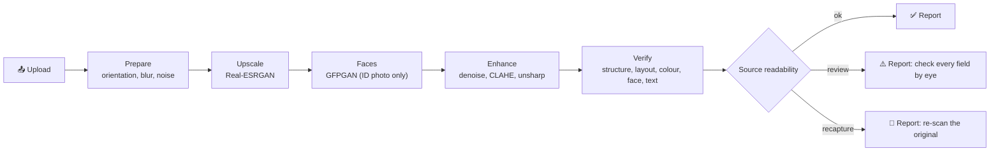

<div align="center">

# 🪪 IDRestore AI

**Restore faded, noisy and low-resolution employee ID photos and HR scans, and know when an image is too damaged to trust.**


[✨ Features](#-features) · [🔬 How it works](#-how-it-works) · [🚀 Quick start](#-quick-start) · [🔌 API](#-api) · [❓ FAQ](#-faq--troubleshooting) · [🗺️ Roadmap](#️-roadmap)

</div>

---

## 💡 Why this exists

Legacy HR records are full of old ID card photos and scans. Before they go into an HRMS, someone has to clean them up, and then decide whether the result can be trusted as the record. IDRestore AI does both:

1. **Restores** the image with a classical + deep-learning pipeline.
2. **Measures** how closely the output still matches the original.
3. **Checks the source**: if the original was too blurry to recover, it says so plainly instead of handing out a high score.

> [!IMPORTANT]
> Restoration cannot bring back detail that is not in the file. If a model makes a very blurry image look readable, it is **guessing** the text and faces. For HR records, that is a risk, not a feature.

## ✨ Features

| | Feature | Details |
|---|---|---|
| 🔍 | **Upscaling** | Real-ESRGAN x4, with an OpenCV Lanczos + unsharp fallback |
| 🙂 | **Face restoration** | GFPGAN v1.4, blended with the original face using an identity slider |
| 🎛️ | **Enhancement** | Denoise, levels, CLAHE contrast and unsharp, all adjustable |
| ✅ | **Preservation checks** | Structure, layout, colour, face and text (Tesseract OCR) vs. the original |
| 🚦 | **Readability gate** | Measures the *original's* sharpness and returns `ok`, `review` or `recapture` |
| 🤖 | **AI advisor** | Groq model explains the result to HR in plain language. It only sees measurements, never the image |
| 📦 | **Batch mode** | Up to 20 images, with a restored ZIP and a summary CSV |
| 📄 | **Reports** | Per-image JSON and a downloadable HTML report |
| 🌐 | **Public demo link** | Optional ngrok tunnel |

## 🔬 How it works



<details>
<summary><b>🚦 What the readability gate decides</b></summary>

<br>

| Status | Meaning | What the app shows |
|---|---|---|
| `ok` | Source is sharp enough to restore reliably | Normal result |
| `review` | Source is soft | Amber warning: check every field by eye |
| `recapture` | Source is too blurry to recover | Red warning: re-scan or re-photograph the original. Overall score is capped and the AI advisor's verdict is forced to `recapture_needed` |

Example output for a very blurry source:

```json
{
  "status": "recapture",
  "source_sharpness": 0,
  "message": "The source image is too blurry to recover reliably. Re-scan or re-photograph the original..."
}
```

</details>

<details>
<summary><b>⚠️ Known limits (please read)</b></summary>

<br>

- A heavily out-of-focus or heavily compressed image will not become readable.
- GFPGAN **generates** facial detail. Keep the identity blend below 100% and review ID photos by eye.
- Quality and preservation scores are heuristics. Use the `readability` status and human review for decisions about records.
- The images in the website's Gallery section are **illustrations** of the damage the pipeline repairs, not real outputs.

</details>

## 🧰 Tech stack

| Layer | Tools |
|---|---|
| Backend | Python, FastAPI, Uvicorn, OpenCV, PyTorch, Real-ESRGAN, GFPGAN, pytesseract |
| Frontend | Vite, vanilla JavaScript |
| AI advisor | Groq API |
| Public URL | pyngrok (optional) |

## 🚀 Quick start

**You need:** Python 3.12, Node.js 18+, [Tesseract OCR](https://github.com/tesseract-ocr/tesseract) on your PATH, and (optionally) a [Groq API key](https://console.groq.com).

### 1️⃣ Clone

```bash
git clone https://github.com/JaineshBharti5/idrestore-ai.git
cd idrestore-ai
```

### 2️⃣ Backend

<details open>
<summary><b>🪟 Windows</b></summary>

```powershell
cd backend
python -m venv venv
venv\Scripts\activate
pip install -r requirements.txt
pip install -r requirements-ai.txt
```

</details>

<details>
<summary><b>🍎 macOS / 🐧 Linux</b></summary>

```bash
cd backend
python3 -m venv venv
source venv/bin/activate
pip install -r requirements.txt
pip install -r requirements-ai.txt
```

</details>

Create `backend/.env` (copy `.env.example`) and add your keys:

```env
GROQ_API_KEY=your_groq_key
NGROK_AUTHTOKEN=your_ngrok_token   # only needed for run_public.py
```

> [!WARNING]
> Never commit `.env`. It is already listed in `.gitignore`.

### 3️⃣ Model weights

The weights are too big for GitHub, so download them into `backend/models/`:

```bash
cd backend/models
curl -L -o RealESRGAN_x4plus.pth https://github.com/xinntao/Real-ESRGAN/releases/download/v0.1.0/RealESRGAN_x4plus.pth
curl -L -o GFPGANv1.4.pth https://github.com/TencentARC/GFPGAN/releases/download/v1.3.0/GFPGANv1.4.pth
```

No weights? The app still runs, with the OpenCV fallback.

<details>
<summary><b>⚡ Make it faster with an NVIDIA GPU</b></summary>

<br>

On one test machine a ~500 x 1100 px image took about **100 s on CPU** and about **8 s on an RTX 3050 laptop GPU**.

1. Pick your CUDA build on [pytorch.org/get-started/locally](https://pytorch.org/get-started/locally/) and run the command it gives.
2. Check it worked:

```bash
python -c "import torch; print(torch.cuda.is_available())"
```

It should print `True`.

</details>

### 4️⃣ Run the backend

```bash
cd backend
uvicorn app.main:app --reload --port 8000
```

Open `http://127.0.0.1:8000/api/health`. It shows which engines (upscaler, faces, OCR, advisor) are active.

### 5️⃣ Run the frontend

```bash
cd frontend
npm install
npm run dev
```

Open **http://localhost:5173** 🎉

<details>
<summary><b>🌍 Share a public demo link (ngrok)</b></summary>

```bash
cd frontend && npm run build
cd ../backend && python run_public.py
```

</details>

## 🔌 API

Interactive docs: `http://127.0.0.1:8000/docs`

```bash
curl -X POST http://127.0.0.1:8000/api/restore \
  -F "file=@old_id.jpg" \
  -F "mode=auto" \
  -F "scale=0"
```

| Field | Values |
|---|---|
| `mode` | `auto`, `id_photo`, `document` |
| `scale` | `0` (auto), `1`, `2`, `4` |

Limits: 15 MB per file, 20 files per batch. Formats: JPG, PNG, WEBP, BMP, TIFF.

## 📁 Project structure

<details>
<summary><b>Click to expand</b></summary>

```
idrestore-ai/
├── backend/
│   ├── app/
│   │   ├── main.py          # FastAPI routes
│   │   ├── pipeline.py      # orchestrates the restore steps
│   │   ├── preprocess.py    # loading, diagnosis, face detection
│   │   ├── upscale.py       # Real-ESRGAN with OpenCV fallback
│   │   ├── face.py          # GFPGAN face restoration
│   │   ├── enhance.py       # denoise, levels, CLAHE, unsharp
│   │   ├── evaluate.py      # preservation checks + readability gate
│   │   ├── advisor.py       # Groq AI advisor
│   │   ├── report.py        # HTML / JSON reports
│   │   └── config.py
│   ├── models/              # downloaded weights (not in git)
│   ├── run_batch.py
│   └── run_public.py
├── frontend/                # Vite app
├── docs/PROJECT_DOCUMENT.md
└── README.md
```

</details>

## ❓ FAQ / Troubleshooting

<details>
<summary><b>The backend root page (<code>/</code>) shows <code>{"detail":"Not Found"}</code></b></summary>

That is normal. The website is served by the frontend at `localhost:5173`, and engine status is at `/api/health`.

</details>

<details>
<summary><b><code>localhost:5173</code> says "refused to connect"</b></summary>

The frontend is not running. Open a terminal in `frontend/` and run `npm run dev`.

</details>

<details>
<summary><b>The AI advisor fails with <code>NotFoundError</code> / <code>model_not_found</code></b></summary>

Groq retires models from time to time. Open `backend/app/config.py`, change `GROQ_MODEL` to a model that is currently listed in the [Groq docs](https://console.groq.com/docs/models), save, and the backend reloads itself.

</details>

<details>
<summary><b><code>/api/health</code> shows <code>"active": false</code> for upscale or face</b></summary>

The weights are missing from `backend/models/`. Follow step 3 above, then restart the backend, because models are loaded at startup.

</details>

<details>
<summary><b><code>torch.cuda.is_available()</code> prints <code>False</code></b></summary>

You have the CPU build of PyTorch. Uninstall it (`pip uninstall -y torch torchvision`) and install the CUDA build from [pytorch.org](https://pytorch.org/get-started/locally/).

</details>

<details>
<summary><b>My very blurry image still looks blurry after restoring</b></summary>

That is expected. The app flags it with a "Re-scan needed" warning, because the detail is not in the file. Re-scan or re-photograph the original in good light.

</details>

## 🗺️ Roadmap

- [x] Real-ESRGAN upscaling with OpenCV fallback
- [x] GFPGAN face restoration with identity blend
- [x] Preservation checks (structure, layout, colour, face, text)
- [x] Source readability gate (`ok` / `review` / `recapture`)
- [x] AI advisor that cannot override the readability gate
- [x] Batch mode with ZIP and CSV

## 🤝 Contributors

<a href="https://github.com/JaineshBharti5">JaineshBharti5</a> ·
<a href="https://github.com/SiramGanesh">SiramGanesh</a> ·
<a href="https://github.com/saachiahuja02">saachiahuja02</a>
<a href="https://github.com/DevDobariya13">DevDobariya13</a>

<!--
Screenshots: add a docs/screenshots folder, then uncomment:

-->
